# 幼儿园管理系统

> 🎓 **计算机毕业设计 · 幼儿园管理系统**
>
> 本仓库只放**项目介绍 + 运行截图**（截图是站点带水印的原图，存在仓库 `images/` 里）。
>
> 👉 **完整可运行源码 / 数据库脚本 / 部署文档：[点我获取](https://geekcode.top/archives/%E5%B9%BC%E5%84%BF%E5%9B%AD%E7%AE%A1%E7%90%86%E7%B3%BB%E7%BB%9F?utm_source=github)**
>
> 💬 咨询微信：**ir9372**　|　🌐 更多项目：[极客代码 geekcode.top](https://geekcode.top/?utm_source=github)
>
> 📌 项目详情页：<https://geekcode.top/archives/%E5%B9%BC%E5%84%BF%E5%9B%AD%E7%AE%A1%E7%90%86%E7%B3%BB%E7%BB%9F?utm_source=github>

<table><td width="230" align="center"> <b>扫码加微信 ir9372</b></td><td valign="middle">📦 源码 = 项目介绍 + 全部运行截图 + 数据库 + 部署文档 👉 点上方任意截图，直接跳到 <b>极客代码 geekcode.top</b> 详情页</td></table>

---

<h1>幼儿园管理系统</h1>
<h2>项目概述</h2>

幼儿园管理系统旨在为学前教育机构提供一体化的数字化管理解决方案，解决传统手工记录效率低、数据分散及监管困难等问题。系统核心功能涵盖幼儿信息管理、教职工考核、膳食菜谱与原料监控、班级资源调度、考勤请假流程以及财务缴费记录等关键业务场景。适用人群包括幼儿园行政管理人员、后勤主管及财务人员。技术架构采用前后端分离模式，后端基于 Spring Boot 框架构建高可用服务层，前端通过 Vue 集成方案实现交互界面，数据存储依托 MySQL 数据库，并引入 Shiro 框架保障系统安全认证与授权，确保管理流程的规范性与数据的安全性。

<h2>技术架构</h2>

本项目采用典型的前后端分离架构设计，整体技术栈以 Java 生态为核心，结合主流前端框架，构建稳定、高效的管理平台。

<strong>1. 后端架构</strong>
后端服务基于 <strong>Spring Boot</strong> 框架开发，利用其自动配置和起步依赖特性简化了应用搭建过程。持久层选用 <strong>MyBatis-Plus</strong> 作为 ORM 映射工具，在保留 MyBatis 灵活性的基础上，提供了通用的 CRUD 操作封装，显著提升了开发效率并减少了样板代码。数据库连接池使用 Spring JDBC 标准组件，驱动采用 <code>mysql-connector-java</code>。安全层面集成 <strong>Apache Shiro</strong>，负责用户身份认证（Authentication）和访问控制（Authorization），确保只有经过授权的管理员才能访问敏感后台模块。此外，项目中引入了 <code>protobuf-java</code> 用于特定场景下的数据传输序列化优化，以及 <code>commons-lang3</code> 和 <code>validation-api</code> 分别处理通用工具逻辑和数据校验规则。

<strong>2. 前端架构</strong>
项目类型为 <code>vue-integrated</code>，表明前端采用 Vue.js 框架进行视图层开发。由于该项目无独立前台路由且仅包含后台管理功能，前端主要聚焦于后台管理界面的构建，通过动态路由加载不同的业务模块页面，实现单页应用（SPA）的良好用户体验。

<strong>3. 数据库设计要点</strong>
数据库基于 MySQL 构建，表结构设计紧密围绕业务实体展开。主要数据表包括但不限于：幼儿信息表、教师/职工信息表、班级信息表、菜谱与原料关联表、体检记录表、请假审批表、缴费明细表、工作日志表及会议记录表。各表之间通过外键或业务ID建立关联，例如“幼儿”与“班级”、“教师”与“考核记录”之间的映射关系，确保数据的一致性与完整性。

<a href="https://geekcode.top/archives/%E5%B9%BC%E5%84%BF%E5%9B%AD%E7%AE%A1%E7%90%86%E7%B3%BB%E7%BB%9F?utm_source=github" title="查看完整源码">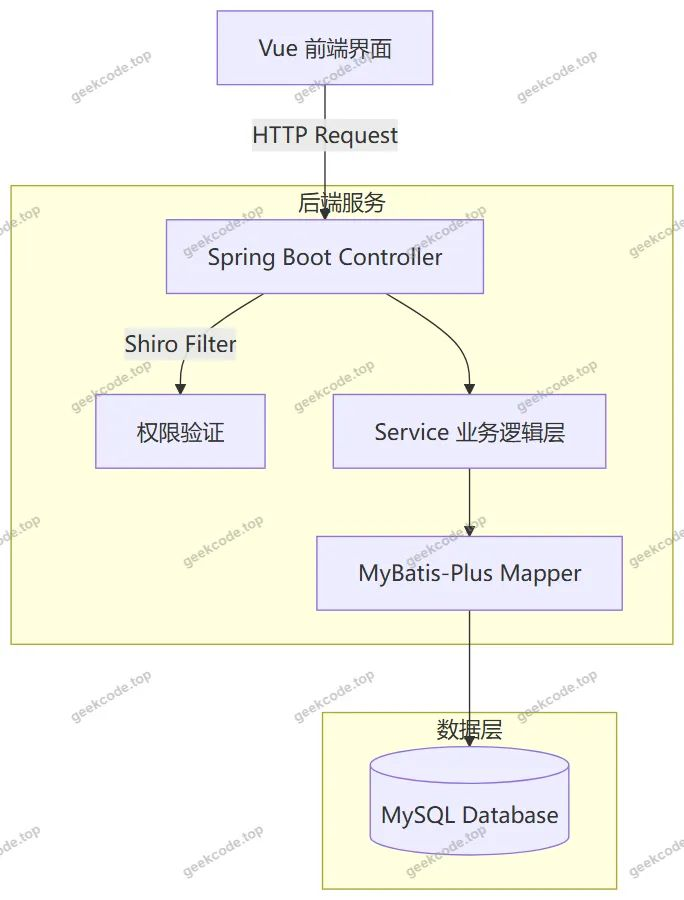</a>

<h2>功能模块</h2>

本系统专注于后台管理功能的实现，未设置面向公众的前台展示页面。所有功能模块均通过后台路由进行访问，具体模块划分如下：

<h3>1. 基础信息管理模块</h3>
<ul>
<li><strong>幼儿信息管理 (<code>/youerxinxi</code>)</strong>：录入、查询、修改和删除幼儿的详细档案，包括基本信息、所属班级等。</li>
<li><strong>教师信息管理 (<code>/jiaoshi</code>)</strong>：维护教职工的基本资料、职位信息及联系方式。</li>
<li><strong>班级信息管理 (<code>/banjixinxi</code>)</strong>：管理班级名称、容纳人数、班主任分配等班级属性。</li>
<li><strong>用户管理 (<code>/yonghu</code>)</strong>：系统登录账号的管理，支持新增、禁用或删除管理员账户。</li>
</ul>
<h3>2. 教学与日常运营模块</h3>
<ul>
<li><strong>菜谱信息管理 (<code>/caipuxinxi</code>)</strong>：制定并发布每周或每日食谱，供内部存档与管理。</li>
<li><strong>原料信息管理 (<code>/yuanliaoxinxi</code>)</strong>：记录食材采购来源、库存量及规格，配合菜谱进行成本核算参考。</li>
<li><strong>资源信息管理 (<code>/ziyuanxinxi</code>)</strong>：管理园所内的教具、玩具、图书等固定资产或消耗品资源。</li>
<li><strong>儿童体检管理 (<code>/ertongtijian</code>)</strong>：记录幼儿定期健康检查的数据，如身高、体重、视力等指标。</li>
</ul>
<h3>3. 人事与行政办公模块</h3>
<ul>
<li><strong>职工考核管理 (<code>/zhigongkaohe</code>)</strong>：记录教职工的工作绩效评估结果，支持多维度打分与归档。</li>
<li><strong>工作日志管理 (<code>/gongzuorizhi</code>)</strong>：员工提交每日工作总结，管理者可查看审核，形成电子化工作轨迹。</li>
<li><strong>会议记录管理 (<code>/huiyijilu</code>)</strong>：保存园内各类会议的纪要、决议事项及参会人员信息。</li>
<li><strong>待办事项管理 (<code>/daibanshixiang</code>)</strong>：个人任务提醒与跟踪，帮助管理人员规划日常工作优先级。</li>
</ul>
<h3>4. 流程审批与财务模块</h3>
<ul>
<li><strong>请假信息管理 (<code>/qingjiaxinxi</code>)</strong>：处理教职工或家长的请假申请，记录请假类型、时长及审批状态。</li>
<li><strong>幼儿请假管理 (<code>/youerqingjia</code>)</strong>：专门针对幼儿缺勤情况的登记与原因说明，便于统计出勤率。</li>
<li><strong>缴费信息管理 (<code>/jiaofeixinxi</code>)</strong>：记录学费、餐费等各项费用的缴纳情况，生成财务报表依据。</li>
</ul>
<h2>用户角色与权限</h2>

根据现有源码结构与截图信息，系统主要服务于内部管理需求，未体现多租户或外部用户自助服务功能。因此，系统角色体系相对扁平，主要由超级管理员构成核心操作群体。

<strong>1. 管理员 (Admin)</strong>
这是系统中唯一明确可见的角色，拥有最高权限，可访问所有后台路由模块。

<ul>
<li><strong>可访问功能</strong>：</li>
<li><strong>全量数据管理</strong>：增删改查幼儿信息、教师信息、班级信息、用户账号。</li>
<li><strong>运营监控</strong>：查看和管理菜谱、原料、资源、儿童体检数据。</li>
<li><strong>行政事务</strong>：编辑职工考核记录、审阅工作日志、管理会议记录、处理待办事项。</li>
<li><strong>流程审批</strong>：审核请假信息（含教职工与幼儿）、核对缴费信息。</li>
<li><strong>系统配置</strong>：通过 <code>ConfigController</code> 和 <code>CommonController</code> 可能涉及的基础参数配置（虽未在路由中直接体现，但控制器存在暗示）。</li>
</ul>

<strong>2. 普通用户/其他角色</strong>

<ul>
<li><strong>状态说明</strong>：根据提供的上下文，系统未定义独立的“教师端”、“家长端”或“学生端”登录入口及对应的前台路由。虽然存在 <code>DefaultuserController</code>，但其具体业务逻辑未在截图中体现为独立的功能菜单。因此，在当前版本中，所有业务操作均由管理员统一执行或通过管理员界面间接完成。若需区分权限，通常依赖于 Shiro 的角色注解，但在缺乏更多细节的情况下，目前视为单一管理员角色主导系统运行。</li>
</ul>
<h2>项目特色与创新点</h2>

<strong>1. 垂直领域深度定制</strong>
不同于通用的教务管理系统，本项目针对幼儿园特有的“保教结合”场景进行了精细化建模。特别设计了“菜谱-原料”联动管理模块，将食品安全与营养搭配纳入数字化管控范围，体现了对学前儿童健康成长的重视。同时，“儿童体检”与“幼儿请假”的独立模块设计，强化了家园共育中的数据透明度与健康追踪能力。

<strong>2. 全流程闭环管理</strong>
系统覆盖了从人员入职（教师信息）、日常考勤（请假、工作日志）、绩效考核（职工考核）到后勤保障（资源、缴费）的全生命周期。通过“待办事项”与“会议记录”的结合，实现了行政指令的下达与反馈闭环，提升了园所内部沟通协作的效率。

<strong>3. 轻量级高效架构</strong>
采用 Spring Boot + MyBatis-Plus 的组合，在保证企业级应用稳定性的同时，极大降低了开发与维护成本。Shiro 框架的引入确保了系统在无需复杂 OAuth2 协议下的快速安全落地，适合中小型幼儿园私有化部署的需求，兼顾了安全性与易用性。

<h2>部署环境</h2>

为确保幼儿园管理系统正常运行，服务器及客户端需满足以下软件环境要求：

<strong>1. 服务端环境</strong>

<ul>
<li><strong>操作系统</strong>：Linux (CentOS 7+, Ubuntu 18.04+) 或 Windows Server 2016+。</li>
<li><strong>Java 运行环境</strong>：JDK 1.8 及以上版本（推荐 JDK 1.8 以兼容 Spring Boot 旧版本及 MyBatis-Plus）。</li>
<li><strong>数据库</strong>：MySQL 5.7 或 MySQL 8.0。需创建专用数据库实例，并导入初始化 SQL 脚本以建立表结构及初始数据。</li>
<li><strong>Web 容器</strong>：内置 Tomcat（由 Spring Boot Starter Web 提供），无需单独安装外部 Tomcat。</li>
</ul>

<strong>2. 客户端环境</strong>

<ul>
<li><strong>浏览器</strong>：Google Chrome, Microsoft Edge, Firefox 等现代主流浏览器的最新稳定版。</li>
<li><strong>网络要求</strong>：稳定的局域网或互联网连接，用于访问后台管理界面。</li>
</ul>

<strong>3. 开发环境（如需二次开发）</strong>

<ul>
<li><strong>IDE</strong>：IntelliJ IDEA 或 Eclipse。</li>
<li><strong>构建工具</strong>：Maven 3.6+。</li>
<li><strong>前端构建</strong>：Node.js (LTS 版本) 及 npm/yarn，用于编译 Vue 前端资源。</li>
</ul>
<h2>五、技术特性</h2>
<ul>
<li>前后端集成部署，前端资源打包至后端 static 目录</li>
<li>使用 MyBatis-Plus 简化数据访问层开发</li>
<li>集成 Shiro 权限框架实现角色权限控制</li>
</ul>
<h2>六、功能模块截图</h2>
<h3>后台管理端</h3>
<h4>后台-班级信息</h4>

<a href="https://geekcode.top/archives/%E5%B9%BC%E5%84%BF%E5%9B%AD%E7%AE%A1%E7%90%86%E7%B3%BB%E7%BB%9F?utm_source=github" title="查看完整源码">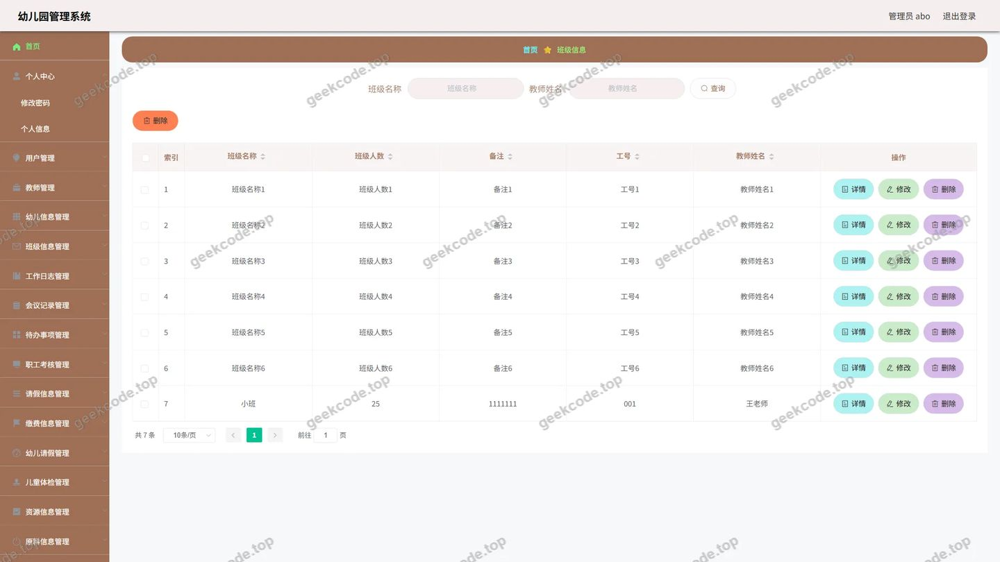</a>

<h4>后台-菜谱信息</h4>

<a href="https://geekcode.top/archives/%E5%B9%BC%E5%84%BF%E5%9B%AD%E7%AE%A1%E7%90%86%E7%B3%BB%E7%BB%9F?utm_source=github" title="查看完整源码">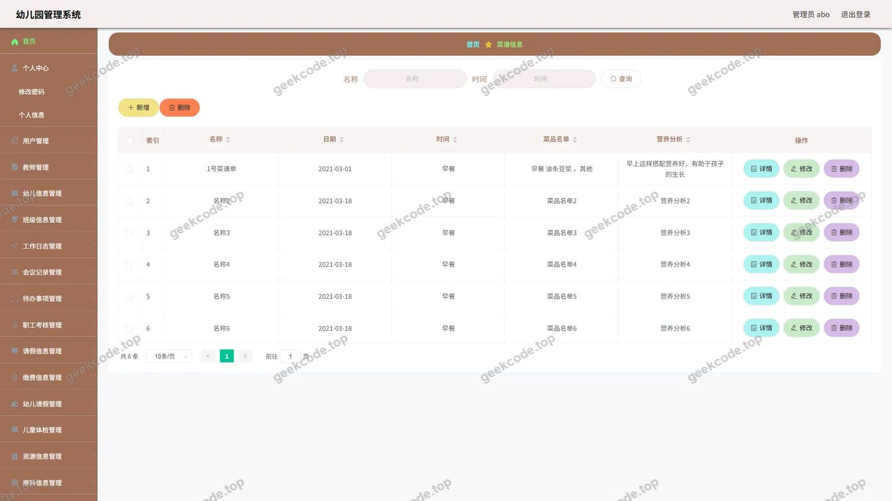</a>

<h4>后台-待办事项</h4>

<h4>后台-儿童体检</h4>

<a href="https://geekcode.top/archives/%E5%B9%BC%E5%84%BF%E5%9B%AD%E7%AE%A1%E7%90%86%E7%B3%BB%E7%BB%9F?utm_source=github" title="查看完整源码">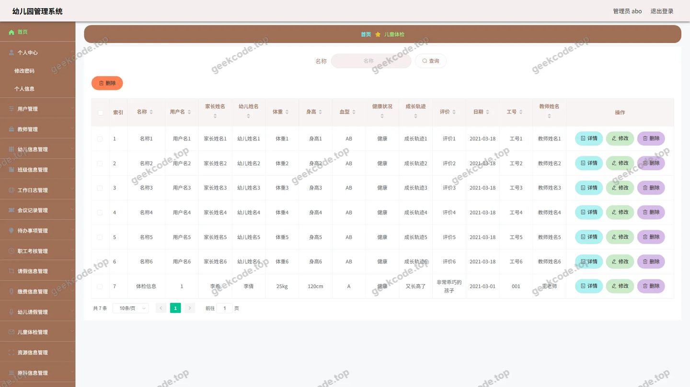</a>

<h4>后台-工作日志</h4>

<h4>后台首页</h4>

<a href="https://geekcode.top/archives/%E5%B9%BC%E5%84%BF%E5%9B%AD%E7%AE%A1%E7%90%86%E7%B3%BB%E7%BB%9F?utm_source=github" title="查看完整源码">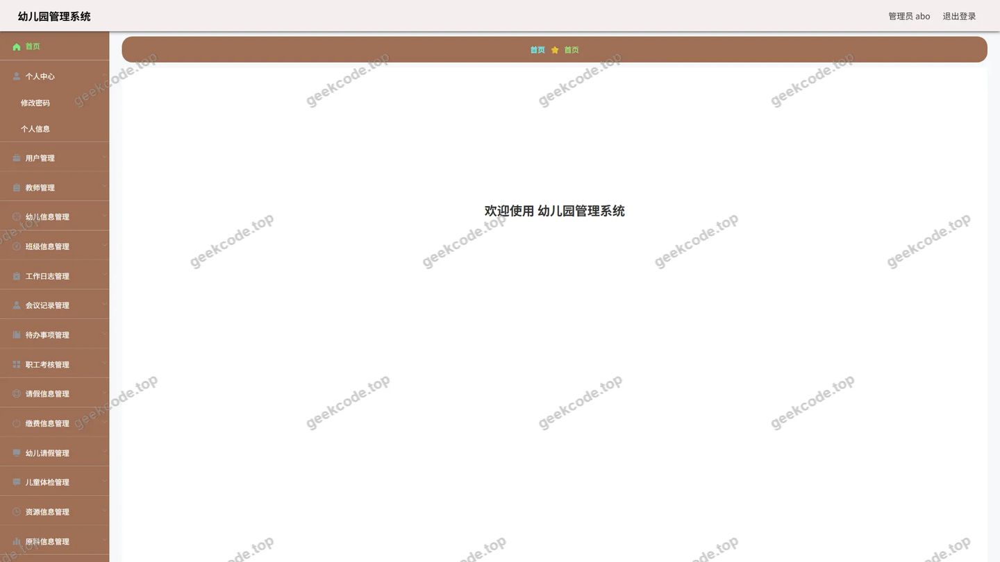</a>

<h4>后台-会议记录</h4>

<a href="https://geekcode.top/archives/%E5%B9%BC%E5%84%BF%E5%9B%AD%E7%AE%A1%E7%90%86%E7%B3%BB%E7%BB%9F?utm_source=github" title="查看完整源码">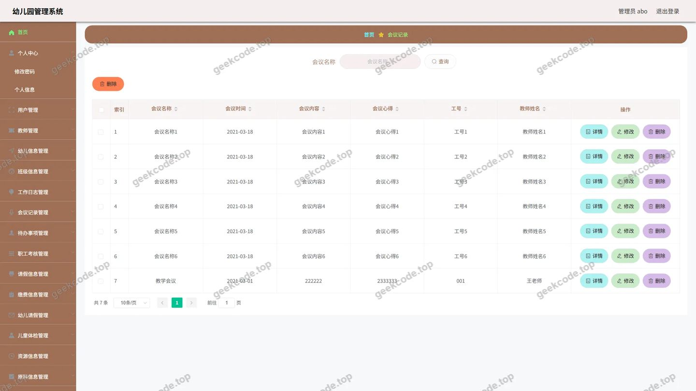</a>

<h4>后台-缴费信息</h4>

<h4>后台-教师</h4>

<a href="https://geekcode.top/archives/%E5%B9%BC%E5%84%BF%E5%9B%AD%E7%AE%A1%E7%90%86%E7%B3%BB%E7%BB%9F?utm_source=github" title="查看完整源码">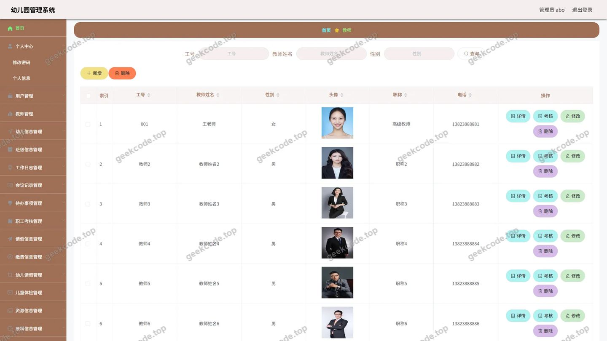</a>

<h4>后台-登录</h4>

<a href="https://geekcode.top/archives/%E5%B9%BC%E5%84%BF%E5%9B%AD%E7%AE%A1%E7%90%86%E7%B3%BB%E7%BB%9F?utm_source=github" title="查看完整源码">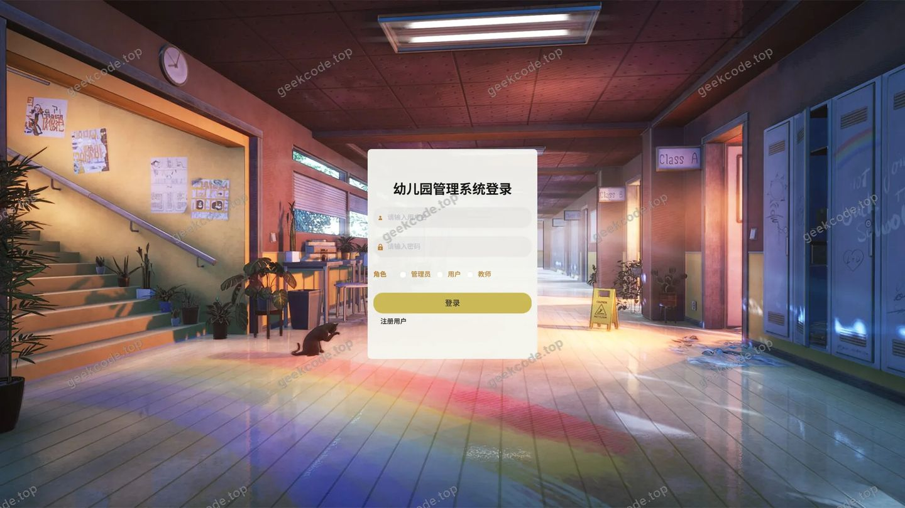</a>

<h4>后台-请假信息</h4>

<h4>后台-幼儿请假</h4>

<a href="https://geekcode.top/archives/%E5%B9%BC%E5%84%BF%E5%9B%AD%E7%AE%A1%E7%90%86%E7%B3%BB%E7%BB%9F?utm_source=github" title="查看完整源码">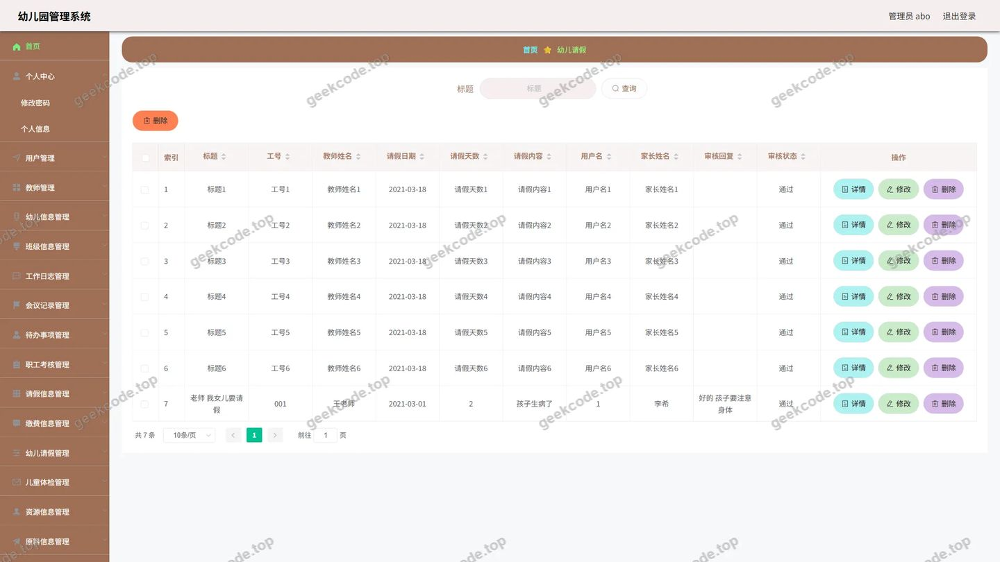</a>

<h4>后台-幼儿信息</h4>

<h4>后台-原料信息</h4>

<a href="https://geekcode.top/archives/%E5%B9%BC%E5%84%BF%E5%9B%AD%E7%AE%A1%E7%90%86%E7%B3%BB%E7%BB%9F?utm_source=github" title="查看完整源码">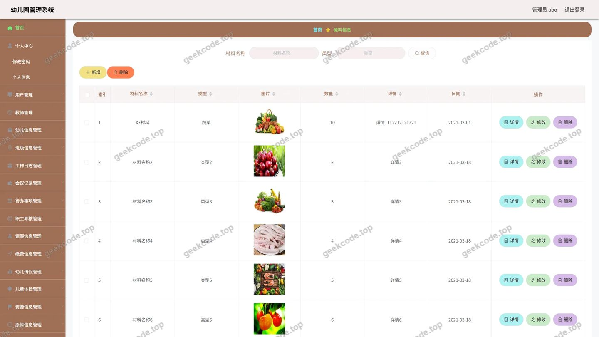</a>

<h4>后台-职工考核</h4>

<h4>后台-资源信息</h4>

<a href="https://geekcode.top/archives/%E5%B9%BC%E5%84%BF%E5%9B%AD%E7%AE%A1%E7%90%86%E7%B3%BB%E7%BB%9F?utm_source=github" title="查看完整源码">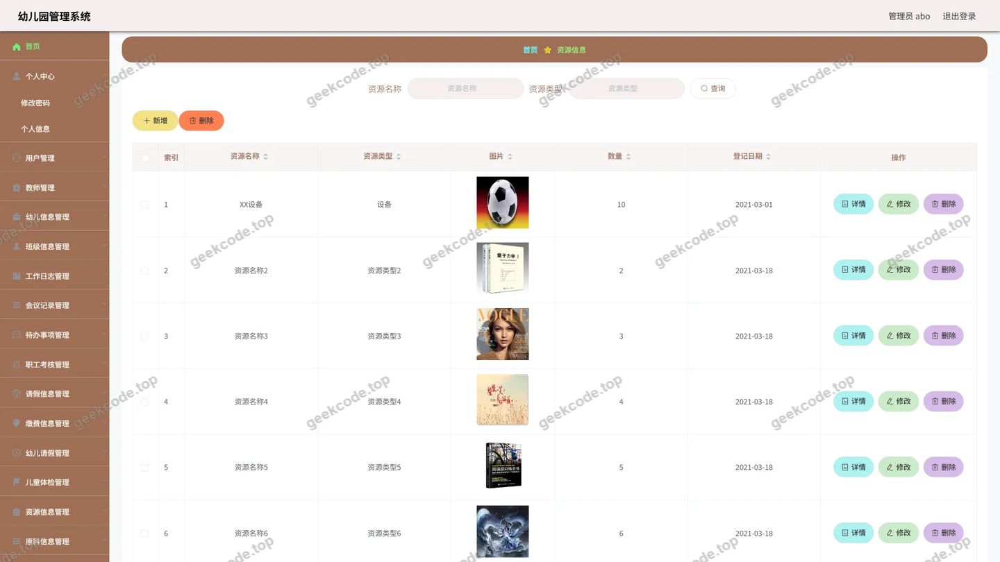</a>

---

## 获取完整源码

| 项目 | 说明 |
| --- | --- |
| 项目名 | 幼儿园管理系统 |
| 运行截图 | 本文 17 张（站点带水印原图，仓库 `images/` 目录） |
| 完整源码 | [https://geekcode.top/archives/%E5%B9%BC%E5%84%BF%E5%9B%AD%E7%AE%A1%E7%90%86%E7%B3%BB%E7%BB%9F?utm_source=github](https://geekcode.top/archives/%E5%B9%BC%E5%84%BF%E5%9B%AD%E7%AE%A1%E7%90%86%E7%B3%BB%E7%BB%9F?utm_source=github) |
| 咨询微信 | **ir9372**（备注：jingpin-yuanma） |
| 更多项目 | [极客代码 geekcode.top](https://geekcode.top/?utm_source=github) |

> 需要源码、部署、改配置、跑不起来等问题，加微信 ir9372 沟通，说明项目名即可。
